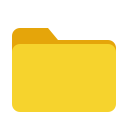

<p align="center">
  
</p>

<h1 align="center">Foldav</h1>

<p align="center">A file manager for GNOME, made for the files in your Nextcloud.</p>

<p align="center">
  <a href="LICENSE"></a>
  <a href="https://github.com/AperteDev/foldav/actions/workflows/ci.yml"></a>
  <a href="https://github.com/AperteDev/foldav/releases/latest"></a>
  <a href="https://aur.archlinux.org/packages/foldav-bin"></a>
  <a href="https://copr.fedorainfracloud.org/coprs/selfref/foldav/"></a>
</p>

Foldav (*folder* + DAV) is the sibling of [Todav](https://github.com/AperteDev/todav) and
[Notav](https://github.com/AperteDev/notav). It is at a very early stage: you can sign in
(GNOME Online Accounts, the browser or an app password), with more than one account, and browse
the folders of your Nextcloud Files. Everything else is planned: see the
[roadmap](docs/ROADMAP.md) and [features](docs/FEATURES.md).

Foldav is developed in my free time. If it helps you with your files, you can support its
development:

<p align="center">
  <a href="https://ko-fi.com/N5E229GJPZ"></a>
  <a href="https://github.com/sponsors/SelfRef"></a>
  <a href="https://liberapay.com/SelfRef/donate"></a>
</p>

## Getting started

Foldav needs GNOME 49 or newer. Download a package from the
[latest release](https://github.com/AperteDev/foldav/releases/latest), or install it from the
AUR (`foldav`, `foldav-bin` or `foldav-git`) or COPR (`dnf copr enable selfref/foldav`):

```sh
# Flatpak, on any distribution (the GNOME runtime comes from Flathub)
flatpak install --user dev.aperte.Foldav.flatpak

# Ubuntu 26.04 and newer
sudo apt install ./foldav_<version>_amd64.deb

# Other distributions: the same files to unpack into /
sudo tar -xzf foldav-<version>-x86_64.tar.gz -C /
```

Then open Foldav and sign in to your Nextcloud.

## Translations

Foldav speaks English and Polish, and follows your GNOME language. Missing your language? Ask for
it in an [issue](https://github.com/AperteDev/foldav/issues), or translate it yourself (see
[CONTRIBUTING.md](docs/CONTRIBUTING.md#translations)).

## Building

Needs Rust, GTK 4.14+, libadwaita 1.8+, libsecret, SQLite, `blueprint-compiler` and gettext.

```sh
cargo run -p foldav-linux      # or: make -C foldav/linux sandbox
cargo test --workspace
```

## License

GPL-3.0-or-later, see [LICENSE](LICENSE).
